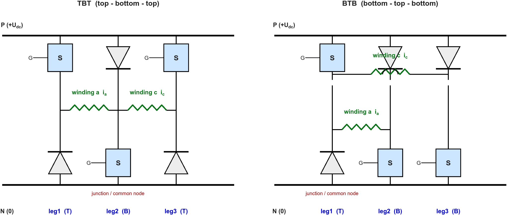

# AMB Half 3-Legs Topology: Minimal Modeling and Verification

A 5-DOF AMB drives 8 radial + 2 axial windings (10 coils). Each coil carries a
**unidirectional** current made of a bias term plus a differential control term, and the usable
control variable is the difference of a winding pair, `i_a - i_c`. A conventional drive needs
four switching legs per pair (two half-H bridges, two legs each). A **half 3-legs** cell does
it with **three legs per pair**: two windings share one leg, and that shared leg carries the
**sum** of both winding currents.

This skill gives the minimum Simulink/Simscape model that verifies such a topology and its
current loop, states explicitly what may be ignored while the model is used for **topology
verification only**, and lists the checks that prove the topology is modelled correctly.

Verified reference implementation: 5 cells (3 TBT + 2 BTB), 10 windings, 5 DOF. The model
itself ships with this skill in `model/` (see section 7), and the measurements are written up in
`references/case-half-3-legs-amb.md` and `references/block-and-parameter-map.md`.

## When to Use

- Building or reviewing an AMB winding-drive power stage based on half 3-legs cells (three
  legs driving two windings), and its per-winding current loop, in Simulink/Simscape.
- Choosing between the two dual arrangements, **TBT** (top-bottom-top) and **BTB**
  (bottom-top-bottom), and understanding why they need different gate-polarity handling.
- Deciding whether a modelling detail (device drops, dead time, magnetics, motion, position
  loop, bus non-idealities, filter bandwidth, gate level, saturation limits, test profiles)
  belongs in a topology-verification model.
- Diagnosing a topology model: steady-state current offset, duty cycles that do not satisfy the
  modulation law, unexplained ripple, very small solver steps, or an algebraic loop.

## When NOT to Use

- Engineering-grade design: loss/thermal budgets, EMI, protection, bus capacitor sizing, device
  selection, digital controller implementation. Those need the effects this skill drops.
- Position/force loop tuning, rotor dynamics, or AMB controller (displacement) design - those
  require a plant model that a topology-verification model deliberately omits.
- Closed-loop bandwidth calibration of the differential (control) current channel - that is a
  controller-design task, not a topology-verification task. See section 0.
- Building the Simulink model mechanically (block insertion, wiring syntax) - use the
  `building-simulink-models` skill for the mechanics; this skill supplies the design content.

## 0. First principle: a topology-verification model needs only the core chain

Keep exactly these seven things, and nothing else by default:

1. A stiff DC bus (one ideal voltage source).
2. One half 3-legs cell per winding pair: 3 legs, each leg = **one controlled switch plus
   one diode** (no dead time - see section 1.4).
3. Each winding as a series R-L branch (plus a current sensor).
4. A wiring that makes each winding current **unidirectional by construction**.
5. Differential reference generation: `i_a_ref = bias + 0.5*i_ref`,
   `i_c_ref = bias - 0.5*i_ref`. A **constant** `i_ref` is enough.
6. A per-winding per-unit PI current controller with an output clamp.
7. One symmetric triangular carrier per cell plus min-max common-mode injection, producing the
   three gate commands.

Everything else is deferred. **Do not volunteer engineering-grade additions** - device
`Vf`/`Ron`, dead time, switching or conduction loss, thermal networks, magnetic saturation,
mutual coupling, iron/eddy loss, back-EMF, motion equations, force models, position loops, bus
impedance, protection and fault logic, quantisation, computation delay, filter bandwidth
selection, gate-drive level selection, saturation-limit selection, control-current readout
blocks, dynamic test profiles. In a topology-verification model these only slow the simulation
and obscure the switching-state behaviour that is being verified.

**Why a constant `i_ref` is the right stimulus.** The question a topology-verification model
must answer is "can this topology drive the control current to the value I ask for?". A constant
reference answers it directly and cheaply: if the steady-state `i_a - i_c` settles on the
reference, the topology has that capability. Step/chirp/sweep profiles, reversal tests and
linear-range boundary tests belong to the later **bandwidth and controller-design** stage, where
an engineering-grade model is required anyway.

**Why it is fine not to wire up `i_a - i_c`.** The control current is a two-signal difference.
It can always be formed in post-processing from the two logged winding currents, so no
subtraction block is required for verification. Add one only if a human reader needs it on a
scope - it is a readability convenience, never a correctness requirement.

The **only** two items that must never be dropped are simulation mechanics, because they
silently corrupt the very quantity being verified (the winding current): current-feedback
**sampling** and solver **event resolution** - see section 3.

## 1. Topology skeleton (build recipe)

### 1.1 The cell: three legs, two windings

Name the two bus rails **P** (bus positive, `+U_dc`) and **N** (bus negative, 0), and the
three leg midpoints **M1**, **A1**, **C1**. One cell drives two windings, `a` and `c`:

- winding `a` sits between the **T leg** and the **B leg** of the cell;
- winding `c` sits between the **B leg** and the other **T leg**.

A **T leg** is a leg whose *upper* device is the controlled switch (lower device is a diode). A
**B leg** is a leg whose *lower* device is the controlled switch (upper device is a diode).

**Fix the winding current sign convention first**: the current sensor of every winding is
oriented so that **positive current flows from the T leg to the B leg** through the winding.
With this convention `i_a` and `i_c` mean the same physical direction in both arrangements,
so the two cell types can be compared directly.

### 1.2 TBT and BTB: the two dual arrangements

| | leg 1 | leg 2 | leg 3 | shared leg (junction node) |
|---|---|---|---|---|
| **TBT** (top-bottom-top) | T | **B** | T | leg 2 (a B leg, drawn in the middle); junction node A1 |
| **BTB** (bottom-top-bottom) | T | B | B | leg 1 (a T leg, drawn first); junction node M1 |

The two arrangements are **exact duals**: TBT is "one B leg shared by two outer T legs"; BTB is
"one T leg shared by two outer B legs". A BTB drawn as T-B-B *is* the conventional B-T-B: just
swap the labels of leg 1 and leg 2 and the chain becomes B-T-B. Expect a reference model to draw
them this way and do not mistake it for a wiring error.



*Figure 1 - the two dual cells. Left: TBT, leg order T-B-T; the junction node is the midpoint of
the middle B leg (leg 2). Right: BTB, drawn T-B-B; the junction node is the midpoint of the left
T leg (leg 1) - relabel leg 1 <-> leg 2 for the conventional B-T-B view. Both windings of a pair
meet at the junction node, so the winding currents are defined T-leg-to-B-leg in both cells.*

Because the shared leg's midpoint is a different electrical node in each arrangement (A1, the
midpoint of the B leg, in TBT; M1, the midpoint of the T leg, in BTB), the two arrangements need
**different gate-polarity handling** even though they end up with the same duty cycles
(section 1.9).

### 1.3 Device-level netlist

Nodes: P, N, M1 (T leg), A1, C1.

**TBT cell**

| Device | Connects | Gate |
|---|---|---|
| Switch, leg 1 upper (T) | P to M1 | `sw1` |
| Diode, leg 1 lower (freewheel) | N to M1 (anode at N) | - |
| Switch, leg 2 lower (B) | A1 to N | `sw2` |
| Diode, leg 2 upper (freewheel) | A1 to P (anode at A1) | - |
| Switch, leg 3 upper (T) | P to C1 | `sw3` |
| Diode, leg 3 lower (freewheel) | N to C1 (anode at N) | - |
| Winding `a` (R + L + current sensor) | M1 to A1 | - |
| Winding `c` (R + L + current sensor) | A1 to C1 | - |

Here the **shared node is A1** and both winding currents flow *into* it.

**BTB cell**

| Device | Connects | Gate |
|---|---|---|
| Switch, leg 1 upper (T) | P to M1 | `sw2` |
| Diode, leg 1 lower (freewheel) | N to M1 (anode at N) | - |
| Switch, leg 2 lower (B) | A1 to N | `sw1` |
| Diode, leg 2 upper (freewheel) | A1 to P (anode at A1) | - |
| Switch, leg 3 lower (B) | C1 to N | `sw3` |
| Diode, leg 3 upper (freewheel) | C1 to P (anode at C1) | - |
| Winding `a` (R + L + current sensor) | A1 to M1 | - |
| Winding `c` (R + L + current sensor) | M1 to C1 | - |

Here the **shared node is M1** and both winding currents flow *out of* it, into the two B legs.
Note that `sw1` drives the **lower** device of leg 2, and `sw2` drives the **upper** device
of leg 1 - the opposite index mapping from the TBT cell.

In every leg the two devices point the **same way** (both toward M1, or both away from it), so a
leg can never short P to N. That is the origin of the "no dead time" property.

### 1.4 Unidirectional-current proof, winding voltage law, and the shared-leg current

Let `s1`, `s2`, `s3` be the boolean states of the switches commanded by `sw1`, `sw2`,
`sw3`. For the TBT winding `a` (M1 to A1):

| `s1` (leg 1 upper) | `s2` (leg 2 lower) | Current path | `V_a` (ideal) |
|---|---|---|---|
| 1 | 1 | P - sw1 - M1 - winding a - A1 - sw2 - N | `+U_dc` |
| 1 | 0 | P - sw1 - M1 - winding a - A1 - D(leg 2) - P | 0 |
| 0 | 1 | N - D(leg 1) - M1 - winding a - A1 - sw2 - N | 0 |
| 0 | 0 | N - D(leg 1) - M1 - winding a - A1 - D(leg 2) - P | `-U_dc` |

The winding current direction is **M1 to A1 in all four states** - exactly what a biased AMB
winding needs. Two consequences:

- **No dead time is required.** Each leg is a series switch+diode pair that cannot conduct P to
  N; there is no shoot-through path and no dead-time distortion to model.
- The output is **three-level** (`+U_dc`, 0, `-U_dc`) and every freewheel path contains
  **two** devices in series.

The same analysis gives the winding voltage law, identical for both arrangements:

```
V_a = U_dc * (s1 + s2 - 1)
V_c = U_dc * (s3 + s2 - 1)
```

and, by KCL at the shared node, the shared leg carries **`i_a + i_c` at all times** - either
through its switch (to N) or through its diode (to P). With a bias current of `bias` the
shared leg therefore carries about `2*bias`, twice an outer leg. This is the price of using
3 legs instead of 4 per winding pair (a 25 % device-count reduction), and it is the single most
important number to carry into device rating and thermal work later.

### 1.5 Scaling to N winding pairs

Instantiate one cell per winding pair (`N = 2 x DOF`: 8 radial + 2 axial = 10 windings = 5
cells), chain all cells across one bus, and keep the windings floating and independent. There is
no magnetic or electrical coupling between windings in this model, so the N current loops are
decoupled and can each be tuned independently.

### 1.6 Differential (bias) reference generation

For every pair, generate the two winding references from one control-current reference:

```
i_a_ref = bias_current + 0.5 * i_ref
i_c_ref = bias_current - 0.5 * i_ref
```

In Simulink this is a `Gain` (0.5) feeding two `Sum` blocks: one with `Inputs = '++'`
(`+0.5*i_ref + bias`) and one with `Inputs = '-+'` (`-0.5*i_ref + bias`). Reference currents
must stay positive: `|i_ref| < 2*bias_current` is the linearity limit of the differential pair.

**Use a constant `i_ref` for topology verification** (section 0). Any non-zero value inside the
linear range exercises the differential channel; `i_ref = 0` is a useful degenerate check that
both windings settle at exactly the bias current.

### 1.7 Per-winding per-unit PI current controller

Design the loop in per-unit voltage (controller output = `V_winding / U_dc`), which makes the
gains independent of the bus voltage:

```
Kp = 2*pi*f_c*L/U_dc          Ki = 2*pi*f_c*R/U_dc
```

with `f_c` in **Hz**. With this choice the PI zero `Ki/Kp = R/L` cancels the winding pole
exactly, and the open-loop gain becomes `Kp*U_dc/(L*s)`, i.e. a crossover at `f_c` with a
first-order closed loop (about `tau = L/(Kp*U_dc)`). Choose `f_c` around `f_sw/10` to
`f_sw/13`; the sampling delay analysed in section 3.1 then decides how much phase margin is
actually left.

Controller structure (per winding):

```
err      = ref - fbk_filtered            (Sum, Inputs '+-')
U_raw    = Kp*err + integral_term        (Gain + Sum '++')
U_cmd    = clamp(U_raw, -1, +1)          (Saturation, LowerLimit -1, UpperLimit +1)
```

Add **conditional-integration anti-windup**: when the integrator state is at its limit and the
error would push it further (`|x| >= 1` AND `x*err >= 0`), force the integrator input to
zero. Keep the integrator's own output clamp (`LimitOutput = on`, limits +/-1) as the second
line of defence. With per-unit gains a bias-current step rarely reaches the clamp - the
anti-windup is a safety net, not part of the nominal response.

> Naming trap seen in practice: a logic block **named** `AND` may actually be configured with
> `Operator = OR` (that is what makes `|x| >= 1` work). Always read the `Operator`
> parameter, never the block name.

### 1.8 Three-level PWM from one symmetric triangular carrier

One carrier per cell - a symmetric triangle of amplitude 0..1 and period `Ts = 1/f_sw`
(in Simulink a `Repeating Sequence` with `rep_seq_t = [0 Ts/2 Ts]` and
`rep_seq_y = [0 1 0]`). Compare with `>=`. For a symmetric triangle the **duty cycle of the
comparator output equals the comparison threshold** whenever the threshold lies in [0, 1].

**TBT modulator.** Let

```
e1 = u_a - u_c ,  e2 = -u_c ,  e3 = 0
m  = 0.5 * ( max(e1,e2,e3) + min(e1,e2,e3) )        % zero-sequence / common-mode injection
thresholds:  b1 <- 0.5 - m + e1 ,  b2 <- 0.5 - m + e2 ,  b3 <- 0.5 - m
```

and drive the gates as `sw1 = b1`, `sw2 = NOT b2`, `sw3 = b3`. The resulting duties are

```
d1 = 0.5 - m + u_a - u_c      (leg 1, upper / T)
d2 = 0.5 + m + u_c            (leg 2, lower / B,  the shared leg)
d3 = 0.5 - m                  (leg 3, upper / T)
```

**BTB modulator.** Let

```
e1' = u_c - u_a ,  e2' = u_c ,  e3' = 0
m'  = 0.5 * ( max(e1',e2',e3') + min(e1',e2',e3') ) = -m
thresholds:  b1 <- 0.5 - m' + e1' ,  b2 <- 0.5 - m' + e2' ,  b3 <- 0.5 - m'
```

and drive the gates as `sw1 = NOT b1`, `sw2 = b2`, `sw3 = NOT b3`. The duties are

```
d1 = 0.5 - m + u_a - u_c      (leg 2, lower / B,  the shared leg)
d2 = 0.5 + m + u_c            (leg 1, upper / T)
d3 = 0.5 - m                  (leg 3, lower / B)
```

**Both modulators produce exactly the same duty triple** `(d1, d2, d3)` for the same
`(u_a, u_c)`, and both satisfy the design relations

```
d1 + d2 - 1 = u_a        d3 + d2 - 1 = u_c
```

This equivalence is expected: the winding voltage law is identical for the two arrangements, so
the duty constraints are identical too. The two generators differ only in **which** signal is
inverted and which gate it drives; do not expect (or hunt for) a numerical difference in the
duties.

Because the carrier is symmetric, each carrier period contains **two** energise pulses (one on
the rising, one on the falling slope). The effective current-ripple frequency is therefore
`2*f_sw`, not `f_sw`, and the "both switches on" fraction is exactly `u_a` for winding
`a` and `u_c` for winding `c`.

**Useful closed form in the AMB operating region.** For `u_a >= u_c >= 0` (both winding
currents positive, `i_ref >= 0`) the min-max injection collapses to

```
d(shared leg) = d(leg of the larger winding) = 0.5 + max(u_a,u_c)/2
d(other leg)                                  = 0.5 + min(u_a,u_c) - max(u_a,u_c)/2
```

### 1.9 Gate-level map

| Arrangement | `sw1` drives | `sw2` drives | `sw3` drives | Active-low signals |
|---|---|---|---|---|
| TBT | leg 1 **upper** (T) | leg 2 **lower** (B) | leg 3 **upper** (T) | `sw2` |
| BTB | leg 2 **lower** (B) | leg 1 **upper** (T) | leg 3 **lower** (B) | `sw1`, `sw3` |

Gate level is arbitrary in a topology-verification model - a single `Gain` (for example 15) on
each boolean is enough. With ideal switches any non-zero gate level works.

## 2. What you may ignore (and when it stops being safe)

This is the heart of topology design: **most non-ideal effects and essentially all engineering
practice can be dropped**, because they do not change which devices conduct, in which direction,
or the average voltage applied to the winding. Add them back only when the question changes.

| Item | Why it is safe to drop in a topology model | When it stops being safe |
|---|---|---|
| Device `Vf`, `Ron`, `Goff` (use 0) | Shifts the operating duty, not the switching states or the current direction | Loss/thermal budget, efficiency, device selection |
| Dead time (none is needed here) | Every leg is a switch+diode pair that cannot short the bus | Only if you replace a switch+diode leg with a conventional two-switch half-bridge leg |
| Switching transients, `di/dt`, reverse recovery | Do not change the average-current behaviour | EMI, overvoltage, device stress |
| Thermal network, junction temperature | Far slower than the current loop | Any temperature-dependent study |
| Magnetic saturation, mutual coupling, iron/eddy loss | Change `L` and add cross-coupling; not needed to verify switching states | Position dependence, force linearity, high-frequency loss |
| Back-EMF, motion equation, force model, position loop | A motionless winding makes the load a pure R-L branch | Any study of stiffness, damping, or rotor dynamics |
| Bus capacitance, source impedance, pump-up | An ideal source fixes the bus voltage | Regenerative-energy handling, bus sizing, DC-link resonance |
| Protection, fault logic, EMI filtering | Not part of the topology function | Safety or compliance work |
| **Feedback filter bandwidth and damping** | Sets loop phase margin, not the switching states or the modulation law | **Not ignorable if closed-loop bandwidth or stability margin is the question** |
| **Gate-drive level** | Any non-zero level turns an ideal switch on | Real gate-drive design, isolation, `dV/dt` |
| **Controller and integrator clamp values** | Only bound large-signal excursions; nominal response is unchanged | Fault ride-through, saturation recovery, large-signal step response |
| **Differential reference generation factor (0.5)** | Definition of the control current | Never - it *is* the control law |
| **Modulator constants (0.5, 0)** | Part of the per-unit modulation law | Never - they define the duty mapping |
| **Whether `i_a - i_c` is drawn on a scope** | It is a two-signal difference; post-processing gives it exactly | Never for verification; only for human readability |
| **Whether `i_ref` is constant or a dynamic profile** | A constant reference already proves the topology can regulate the control current to a set point | When bandwidth, overshoot, reversal, or linear-range limits are the question |
| Digital implementation detail: quantisation, computation delay, interrupt jitter | Second-order for switching-state verification | When the loop bandwidth itself matters - see section 3.1 |

Rule of thumb: if an effect does not change **which devices conduct**, **in which direction**, or
**the average voltage applied to the winding**, it does not belong in a topology-verification
model. Do not add it "for realism" - it buys nothing and costs simulation time.

## 3. What you must NOT ignore: simulation mechanics

### 3.1 Current-feedback sampling

The feedback path is the one place where a modelling shortcut silently biases the result.

**Counter-example (measured, 10-winding half 3-legs model).** Feeding the winding current
straight into a `Memory` block (used to break the algebraic loop) with a variable-step solver
lets the `Memory` zero-order-hold the value from the *previous major step*. The held value
systematically over-estimates the current. Measured effect: the steady-state winding current
settled **0.43 % low** (i_a = 5.4766 A against a 5.5 A reference) and the control current came
out **0.9966 A instead of 1.0 A**.

**Correct construction.** Sample the feedback at a defined rate, synchronously with the PWM:

- Insert a `Rate Transition` with `OutPortSampleTimeOpt = 'Specify'` and
  `OutPortSampleTime = Ts` (the switching period), with `Integrity = 'on'` and
  `Deterministic = 'on'`; or use a `Zero-Order Hold` with `SampleTime = Ts`.
- Use the **same phase** for the two windings of a pair, so that the difference `i_a - i_c`
  does not inherit a sampling-phase error.
- Keep the `Memory` block **after** the sampler: a `Rate Transition` has direct feedthrough,
  so the sampler alone does **not** break the
  `feedback -> controller -> PWM -> cell -> current -> feedback` algebraic loop. Verified:
  deleting the `Memory` block raises exactly one algebraic-loop diagnostic.
- A second-order low-pass in the feedback path (`fn` around `4*f_c`, `Zeta = 0.707`) is
  conventional and harmless for topology verification, but it does cost phase margin.

Measured benefit of the sampler in the reference model: steady-state error **0.073 % with** the
`Rate Transition` versus **0.425 % without** it - a factor of six.

### 3.2 Solver step size and zero-crossing resolution

- Bound the step: `MaxStep <= Ts/20` (for `f_sw = 20 kHz`, `MaxStep = 1e-6`) and tighten
  `RelTol` to `1e-4` or smaller. Alternatively enable the Simscape local solver - **but see
  the warning below first.**
- **Zero-crossing detection, not `MaxStep`, is what actually resolves the switching edges.** In
  the reference model `MaxStep = 1 us` while the narrowest energise pulse is only
  **0.14 us**; the pulse width is still correct because the variable-step solver brackets the
  comparator zero crossings. Expect a large fraction of sub-nanosecond steps (35 % of 350 775
  steps, smallest `5.7e-30 s`) - they are the price of that accuracy, not a defect.
- Therefore **do not** switch to the Simscape local solver with a 1 us sample time: it would
  quantise the 0.14 us pulse to 0 or 1 us, i.e. about +/-1 % duty-cycle error (roughly +/-50 mA)
  instead of the 4 mA actually achieved. Do not disable zero-crossing detection either.
- Expect the cost: about 16 s per 100 ms of simulated time for a 15-switch / 15-diode model in
  accelerator mode. That is acceptable for topology verification. If you need more speed, lower
  the carrier frequency or shorten the run - do not loosen the numerics.

### 3.3 Measurement hygiene

Always reduce logged data with **time-weighted** averages, `sum(x.*dt)/sum(dt)`, never with
`mean(x)`. A variable-step solver clusters samples around the switching edges, so a plain
sample average of the duty cycle is biased. Likewise, resample the non-uniform time vector onto
a uniform grid before any FFT of the ripple.

## 4. Verification checklist

Run these on the finished model (steady state, at least 10 ms after start-up). Each check has a
pass criterion; all values below are from the verified 5-cell / 10-winding reference model.

| # | Check | How | Pass criterion / reference value |
|---|---|---|---|
| 1 | Duty law | time-weighted duty of all three gates | `d1+d2-1 = u_a` and `d3+d2-1 = u_c` to < 1e-4 |
| 2 | Both-on fraction | time-weighted fraction with `s1=s2=1` (winding a) | equals `u_a` (measured 4.569 % vs `u_a = 0.04569`) |
| 3 | State sequence | list the `s1*4+s2*2+s3` states over 2 carrier periods | 23.86 us freewheel - 1.00 us both-on - 0.14 us a-only - 23.86 us freewheel, twice per 50 us |
| 4 | Current slope | `dI/dt` inside each state | energise `+0.386 A/us` (= (198.4 V - i*R) / 500 uH); freewheel `-0.0172` and `-0.0200 A/us` |
| 5 | Unidirectionality | minimum of every winding current | always >= 0; no zero crossing |
| 6 | Steady-state accuracy | time-weighted currents vs references | within 0.11 % (TBT 0.073 %, BTB 0.103 %) |
| 7 | Control current | `i_a - i_c` (post-processed) vs constant `i_ref` | within 0.1 % (measured 0.9992 / 0.9993 A against 1.0 A) |
| 8 | Ripple spectrum | uniform resample then FFT of one winding | dominant component at `2*f_sw` (measured 40.0 kHz) |
| 9 | Differential ripple | peak-to-peak of `i_a - i_c` | small compared with the winding ripple (0.062 A p-p on a 1 A control current, about 13 %) |
| 10 | Shared-leg current | KCL at the shared node, cross-checked against measured slopes | equals `i_a + i_c` (about `2*bias`) |
| 11 | No algebraic loop | compile the model / read diagnostics | no algebraic-loop warning |
| 12 | Anti-windup | read the `Operator` parameter of the logic blocks | integrator frozen when (`abs(x) >= 1` AND `x*err >= 0`) |
| 13 | Feedback sampling | A/B against a `Memory`-only variant | error improves by several times (0.073 % vs 0.425 %) |

## 5. Reference numbers from the verified case

| Quantity | Value |
|---|---|
| Bus / winding | `U_dc = 200 V`, `R = 1 ohm`, `L = 500 uH` |
| Switching / bias | `f_sw = 20 kHz` (`Ts = 50 us`), `bias_current = 5 A`, `i_ref = 1 A` |
| Controller | `f_c = 1500 Hz`, `Kp = 0.023562`, `Ki = 47.1239`, output clamp +/-1 |
| Feedback filter | second-order low-pass, `fn = 6000 Hz`, `Zeta = 0.707` |
| Steady state (TBT) | `i_a = 5.4960 A`, `i_c = 4.4968 A`, `i_a - i_c = 0.9992 A` |
| Steady state (BTB) | `i_a = 5.4947 A`, `i_c = 4.4954 A`, `i_a - i_c = 0.9993 A` |
| Gate duties (all 5 cells) | `(d1, d2, d3) = (0.5228, 0.5228, 0.5172)` |
| Winding ripple | 0.4727 A p-p (8.6 %), dominant harmonic at `2*f_sw` (0.0732 A) |
| Differential ripple | 0.0620 A p-p |
| Start-up | `t63 = 64 us`, peak 5.8361 A (+6.11 %), minimum 0 |
| Shared-leg current | 5.22 A average through the switch, 4.77 A through the diode |
| Outer-leg currents | 2.87 / 2.62 A (winding a), 2.33 / 2.17 A (winding c) |
| Duty with real device drops | 0.5228 instead of the ideal-device 0.5138 (device drops are NOT in the minimal model; see section 1.4) |
| Runtime | about 16 s per 100 ms with `MaxStep = 1e-6`, accelerator mode |

## 6. Symptom -> cause -> fix

| Symptom | Likely cause | Fix |
|---|---|---|
| Steady-state winding current is a fraction of a percent off while the controller's feedback sits exactly on the reference | Un-sampled (`Memory`-only) feedback held across large variable steps | Add the `Rate Transition` / `Zero-Order Hold` of section 3.1 |
| Time-weighted duty does not satisfy `d1+d2-1 = u_a` | Duty computed as a sample average instead of a time-weighted average | Use `sum(x.*dt)/sum(dt)` |
| The TBT and BTB cells "should" produce different duty cycles but measure identical | They genuinely are identical - only the gate polarity and switch index differ | Nothing to fix; verify the voltage law instead |
| Duty cycles run outside [0, 1] or the current stops tracking | min-max common-mode injection range exceeded (large `u_a - u_c`, i.e. control current near `2*bias`) | Reduce `i_ref`; this is the physical linearity limit |
| Tens of thousands of sub-nanosecond solver steps, slow run | Ideal switches plus zero-crossing detection | Accept it, or lower the carrier frequency; do **not** disable zero-crossing detection or switch to a 1 us local solver |
| Algebraic-loop diagnostic after adding a sampler | `Rate Transition` has direct feedthrough | Keep a `Memory` (or a `Zero-Order Hold`, which has none) in the feedback path |
| Shared leg overheats or its device current is double the outer legs' | By design: the shared leg carries `i_a + i_c` | Rate the shared leg for about `2*bias`; this is a topology property, not a bug |
| Current never reaches zero or reverses during a step | Correct behaviour - the winding current is unidirectional by design | Do not "fix"; verify the differential current `i_a - i_c` instead |
| The BTB cell looks like T-B-B in the diagram | The shared T leg is drawn first instead of in the middle | Relabel leg 1 and leg 2; the circuit is already a correct B-T-B |

## 7. References and bundled files

Everything below lives inside this skill folder, so the skill is self-contained:

| Path | What it is |
|---|---|
| `model/Half_3_Legs_with_RL_load.slx` | the verified reference model: 5 cells (3 TBT + 2 BTB), 10 windings, 5 DOF |
| `model/parameters_for_AMB_topology.m` | the base-workspace parameter script the model depends on |
| `assets/fig1_topology.png` | device-level structure of the two cells (Figure 1) |
| `references/block-and-parameter-map.md` | exact block names, library paths, parameter names and values, port names, Goto/From tags, netlists, and model configuration |
| `references/case-half-3-legs-amb.md` | the full case study: inventory, netlist derivation, modulation-law derivation and measurement, device-drop evidence chain, device-current table, feedback-sampling A/B, reproduction snippets |

### Running the bundled model

Environment in which the bundled model was built and verified:

| | |
|---|---|
| MATLAB | **R2025b (25.2)** |
| Simulink | **25.2** |
| Simscape | **25.2** |
| Platform | Linux (GLNXA64) |

The `.slx` was saved by that release. Opening it in an older release triggers an upgrade prompt
and may not reproduce every block setting; treat R2025b (or a later release) as the supported
environment.

```matlab
cd('<this skill folder>/model')            % folder holding the bundled .slx and .m
run('parameters_for_AMB_topology.m');      % MUST run first - it starts with clearvars
m = 'Half_3_Legs_with_RL_load';
load_system(m);
out = sim(m);                              % StopTime 0.1 s, ~16 s wall clock, accelerator mode
```

`parameters_for_AMB_topology.m` defines the eight base-workspace variables the model needs
(`K_p`, `K_i`, `L_value`, `R_value`, `U_dc`, `SW_Ts`, `half_SW_Ts`, `bias_current`).
Run it before touching any other variable, because its first statement is `clearvars`. Nothing
else needs to be on the MATLAB path - the model and that one script are the only files required.
To log signals or reduce the results, see section 13 of `references/block-and-parameter-map.md`.
