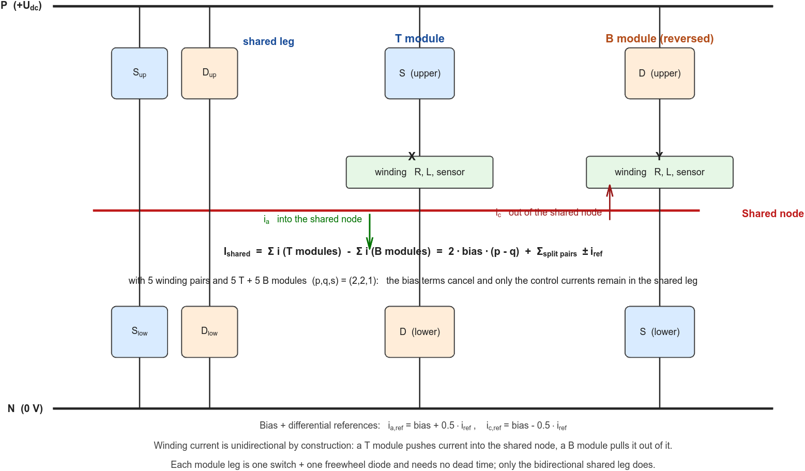

# AMB Reversed Shared Bridge (RSB) Topology: Minimal Modeling and Verification

A 5-DOF AMB drives 8 radial + 2 axial windings (10 coils). Each coil carries a **unidirectional**
current made of a bias term plus a differential control term, and the usable control variable is the
difference of a winding pair, `i_a - i_c`. A conventional drive gives every winding two switching legs
(four legs per pair). The **reversed shared bridge** does it with **one leg per winding plus a single
shared leg**: the shared leg drives one end of *every* winding, each winding has its own independent leg
at the other end, and **half of the independent legs are reversed** (the diode/switch roles swapped, and
the winding's current direction with them). Because the two windings of a pair carry currents whose sum
is the constant `2*bias`, the reversal makes the bias terms cancel at the shared node, so the shared
leg carries only the algebraic sum of the **control** currents - about 1/45 of what a non-reversed
wiring would put there in the verified case.

This skill gives the minimum Simulink/Simscape model that verifies such a topology and its current loop,
states explicitly **what may be ignored** while the model is used for topology verification only, names
the two simulation mechanics that may **not** be ignored, and lists the checks that prove the topology is
modelled correctly.

**Verified reference implementation**: a 10-winding, 5-DOF model bundled at
`model/Reversed_shared_Bridge_with_RL_load.slx` (md5 `80211c88ec9d55c4f5af97db1d07eff0`) together with its
parameters in `model/parameters_for_AMB_topology.m` (md5 `a90c6e390a9c1e14bf015396b2d6054d`), verified with
**MATLAB 25.2 (R2025b), Simulink 25.2, Simscape 25.2 and Simscape Electrical 25.2 (Linux `glnxa64`)**.
The measurements are written up in `references/case-reversed-shared-bridge-amb.md`; every block, parameter
and signal name quoted below is listed in `references/block-and-parameter-map.md` and re-checked by
`scripts/verify_model_facts.m`; the numbers are reproduced by `scripts/run_case_study.m`.

## When to Use

- Building or reviewing an AMB winding-drive power stage that uses **one shared leg for all windings**
  plus one independent leg per winding, and deciding how many/windings which independent legs are
  reversed.
- Choosing how the T-type and B-type modules are distributed over the winding pairs, and predicting the
  resulting shared-leg current before simulating.
- Deciding which effects a **topology-verification** model must keep and which may be dropped
  (section 2) - and which two simulation mechanics must never be dropped (section 3).
- Diagnosing a topology model: a shared-leg current much larger than expected, a control-current error
  concentrated on one winding pair, a large differential ripple on one pair only, a start-up overshoot,
  a duty cycle that does not satisfy the modulation law, an aborted run, or a simulation far slower than
  expected.

## When NOT to Use

- Engineering-grade design: loss/thermal budgets, EMI, protection, bus-capacitor sizing, device
  selection, gate-drive design. Those need exactly the effects this skill tells you to drop.
- Position/force loop tuning, rotor dynamics or AMB controller (displacement) design - a
  topology-verification model has no plant model at all.
- Closed-loop bandwidth calibration of the differential current channel; that belongs to the
  controller-design stage (see section 3.1 for the one feedback detail you must fix before you get
  there).
- Building the Simulink model mechanically (block insertion, wiring syntax) - use the
  `building-simulink-models` skill for the mechanics; this skill supplies the design content.

---

## 0. First principle: a topology-verification model needs only the core chain

Keep exactly these things, and nothing else by default:

1. A stiff DC bus (one ideal voltage source).
2. **One shared leg**: a bidirectional half-bridge (two controlled switches, each with a freewheel
   diode) with complementary gating and a dead time.
3. **One independent leg per winding**, built from **one controlled switch plus one freewheel diode** -
   a *T module* when the switch is the upper device, a *B module* when the switch is the lower device.
4. Each winding as a series R-L branch (plus a current sensor), wired so that its current is
   **unidirectional by construction**.
5. A wiring that reverses **half** of the independent legs (module type B instead of T, and with it the
   winding's current direction), chosen so that the bias currents cancel at the shared node.
6. Differential reference generation: `i_a_ref = bias + 0.5*i_ref`, `i_c_ref = bias - 0.5*i_ref`.
   A **constant** `i_ref` is enough for topology verification.
7. A per-winding per-unit PI current controller with an output clamp and conditional-integration
   anti-windup; one symmetric triangular carrier for the whole model plus **min-max common-mode
   injection**, where the shared leg gets the mid threshold.

Everything else is deferred. **Do not volunteer engineering-grade additions** - device `Vf`/`Ron`, dead
time compensation, switching or conduction loss, thermal networks, magnetic saturation, mutual coupling,
iron/eddy loss, back-EMF, motion equations, force models, position loops, bus impedance, protection and
fault logic, quantisation, computation delay, filter-bandwidth selection, gate-drive level selection,
saturation-limit selection, control-current readout blocks and dynamic test profiles. In a
topology-verification model these only slow the simulation down and obscure the switching-state
behaviour that is being verified.

**Why a constant `i_ref` is the right stimulus.** The question a topology-verification model must answer
is "can this topology drive the control current to the value I ask for, and what current does the shared
leg then carry?". A constant reference answers both directly and cheaply. Step/chirp/sweep profiles,
reversal tests and linear-range boundary tests belong to the later bandwidth and controller-design
stage.

**Why it is fine not to wire up `i_a - i_c`.** The control current is a two-signal difference; it can always
be formed in post-processing from the two logged winding currents. Add a subtraction block only if a
human reader needs it on a scope.

The **only** two items that must never be dropped are simulation mechanics, because they silently corrupt
the very quantity being verified (the winding current): current-feedback **sampling** and solver
**zero-crossing resolution** - sections 3.1 and 3.2.

---

## 1. Topology skeleton (build recipe)

### 1.1 The three building blocks

- **Shared leg** (1 per drive): a half-bridge between bus P and bus N whose midpoint is the node
  **Shared**. All windings return to this node. It must be bidirectional (section 1.4).
- **T module** (normal): the winding sits between the module's own leg midpoint **X** and **Shared**.
  The leg is *upper switch to P* plus *lower diode from N*; the winding current flows **X -> Shared**,
  i.e. *into* the shared node.
- **B module** (reversed): the winding sits between **Shared** and the module's own leg midpoint **Y**.
  The leg is *upper diode to P* plus *lower switch to N*; the winding current flows **Shared -> Y**,
  i.e. *out of* the shared node.

Both module legs are "one switch + one diode pointing the same way", so a module leg can never short the
bus and needs **no dead time**. Only the shared leg, which has two controlled switches, needs one.



*Figure 1 - the reversed shared bridge. The shared leg (a bidirectional half-bridge) drives one end of
every winding; each winding has its own leg at the other end. T modules push current into the shared node, B modules pull
current out of it, so the bias terms cancel and only the control currents appear in the shared leg.*

### 1.2 Device-level netlist

Nodes: **P** (bus positive, `+U_dc`), **N** (bus negative, 0), **Shared**, and the module midpoints
**X** (T module) and **Y** (B module).

**Shared leg** (root level of the model; the two switches are gated complementarily with dead time):

| Device | Connects | Gate |
|---|---|---|
| Switch, upper | P to Shared | `sw0` through the on-delay block |
| Diode, upper freewheel | anode Shared, cathode P | - |
| Switch, lower | Shared to N | `NOT(sw0)` through the on-delay block |
| Diode, lower freewheel | anode N, cathode Shared | - |

**T module** (one per "normal" winding):

| Device | Connects | Gate |
|---|---|---|
| Switch, upper | P (module port `Vcc`) to X | `sw` |
| Diode, lower freewheel | anode N (port `Vdd`), cathode X | - |
| Current sensor | X to the inductor, positive = X -> winding | - |
| Winding (R + L) | sensor/L/R chain to **Shared** | - |

Current path: `X -> sensor -> L -> R -> Shared`. **Positive current flows into the shared node.**

**B module** (one per "reversed" winding):

| Device | Connects | Gate |
|---|---|---|
| Diode, upper freewheel | anode Y, cathode P (port `Vcc`) | - |
| Switch, lower | Y to N (port `Vdd`) | `sw` |
| Current sensor | inductor to Y, positive = winding -> Y | - |
| Winding (R + L) | **Shared** -> R -> L -> sensor -> Y | - |

Current path: `Shared -> R -> L -> sensor -> Y`. **Positive current flows out of the shared node.**

Fix the current sign convention first: **the current sensor of every winding is oriented so that
positive current flows in the direction the module forces it** (into the shared node for a T module, out
of it for a B module). With that convention every winding current is a positive bias-plus-control
current and the shared-node KCL has one consistent sign.

The module connection ports are named `Vcci`, `Shared_i`, `Vddi` (left) and `Vcco`, `Shared_o`,
`Vddo` (right); the modules are chained so that all `Vcc` ports, all `Vdd` ports and all `Shared` ports form
three common rails. The last module of the chain ends in three `Open Circuit` terminators.

### 1.3 Wiring rule and the shared-leg current law

Let each winding pair `k` carry `i_a,k = bias + 0.5*i_ref,k` and `i_c,k = bias - 0.5*i_ref,k`. Write the
shared-node current as the sum over the modules, with a `+` sign for a T module and a `-` sign for a
B module:

```
I_sh(into node) = SUM_T-modules i - SUM_B-modules i
```

Group by pair. A pair whose two windings are **both T modules** contributes `+2*bias`; both B modules
contributes `-2*bias`; a **split pair** (one winding of each type) contributes `+-i_ref,k` depending on
which winding is the T module. Hence

```
I_sh = 2*bias*(p - q) + SUM_over_split_pairs (+-i_ref,k)
```

where `p` = number of all-T pairs, `q` = number of all-B pairs, `s` = number of split pairs, and the module
counts must satisfy `2p + s = N_T`, `2q + s = N_B`.

Two consequences drive the whole design:

- **Bias cancellation is structural**: choose `p = q` and the `2*bias` terms disappear *for any bias
  current and any operating point*. In the verified 10-winding case (5 pairs, 5 T modules, 5 B modules)
  the only solution family is `(p,q,s) = (2,2,1)`, `(1,1,3)` or `(0,0,5)`.
- **What is left is the control current**: the shared leg carries the control currents of the split
  pairs only. With `(2,2,1)` it carries one pair's control current - measured **1.111 A mean** at
  `i_ref` = 1 A, versus **50 A** (= `10*bias`) for a wiring in which no leg is reversed. That is a
  **45x reduction** in mean current stress, and it is the whole point of the topology.

### 1.4 Why the shared leg must be a bidirectional half-bridge

The shared-leg current is an *algebraic sum*, so it changes sign with the operating point and during
transients:

- steady state of the verified case: a **unipolar** pulse train out of the shared node, mean 1.111 A,
  RMS 1.383 A, peak 2.640 A, minimum -0.0025 A;
- during start-up the same leg swings **+6.49 A / -5.82 A**, because the T modules and the B modules
  have complementary "energise windows" inside one carrier period and their currents therefore rise in
  a staggered fashion (section 6).

A switch+diode leg (T or B) can only carry current in one direction, so the shared leg needs **two
controlled switches with freewheel diodes and a dead time**. The module legs, by contrast, are
unidirectional by construction and need neither.

### 1.5 Choosing the module-type assignment across winding pairs

| Assignment (5 pairs) | Shared-leg current (nominal) | Comment |
|---|---|---|
| `(2,2,1)` | `+-i_ref` of the single split pair ~ 1 A | lowest shared-leg stress; one pair is "split" |
| `(1,1,3)` | sum of 3 control currents ~ 3 A | three split pairs |
| `(0,0,5)` | sum of 5 control currents ~ 5 A | every pair split (looks symmetric, is the worst) |

Pick `(2,2,1)` unless there is a reason not to, and then decide **which** pair is the split one. A split
pair suffers two penalties and should therefore carry the least accuracy-critical DOF:

- its **differential ripple** is much larger - measured **0.549 A p-p** against **0.0605 A p-p** for a
  same-type pair, a factor of 9, because the two windings' ripples cancel when both modules are of the
  same type and add when they are not;
- any **common-mode current error** of the two module types (for example the feedback-sampling bias of
  section 3.1) appears **added** in the control current instead of cancelling. In the first version of
  the reference model this turned a 0.9 % per-winding offset into a **-9.9 % control-current error on
  the split pair only**.

With an even number of pairs (4 or 6) an all-same-type assignment exists and the split pair disappears.

### 1.6 Differential (bias) reference generation

For every pair, generate the two winding references from one control-current reference:

```
i_a_ref = bias_current + 0.5*i_ref
i_c_ref = bias_current - 0.5*i_ref
```

Reference currents must stay positive: `|i_ref| < 2*bias_current` is the linearity limit of the differential
pair (the winding current is unidirectional, so `i_c` would have to go negative beyond it). In the verified
case `bias_current` = 5 A, `i_ref` = 1 A, so `i_a` = 5.5 A and `i_c` = 4.5 A.

`i_ref = 0` is a useful degenerate check: both windings must settle at exactly the bias current and the
shared-leg current must fall to zero. It is also the case that exposes the min/max implementation trap
(section 3.2).

### 1.7 Per-winding per-unit PI current controller

Design the loop in per-unit voltage (controller output = `V_winding / U_dc`), which makes the gains
independent of the bus voltage:

```
Kp = 2*pi*f_c*L/U_dc          Ki = 2*pi*f_c*R/U_dc
```

with `f_c` in Hz. With this choice the PI zero `Ki/Kp = R/L` cancels the winding pole exactly and the
open-loop gain becomes `Kp*U_dc/(L*s)`, i.e. a crossover at `f_c` with a first-order closed loop. Choose
`f_c` around `f_sw/10` to `f_sw/13`, and remember that the feedback chain of section 3.1 adds delay.

Controller structure (per winding):

```
err    = ref - fbk_averaged            (Sum, Inputs '+-')
U_raw  = Kp*err + integral_term        (Gain + Sum '++')
U_cmd  = clamp(U_raw, -1, +1)          (Saturation)
```

Add **conditional-integration anti-windup**: when the integrator state is at its limit and the error
would push it further (`|x| >= 1` AND `x*err >= 0`), force the integrator input to zero; keep the
integrator's own output clamp (`LimitOutput = on`, limits +/-1) as the second line of defence.

> Naming trap seen in practice: a logic block **named** `AND` may actually be configured with
> `Operator = OR` (that is what makes `|x| >= 1` work). Always read the `Operator` parameter, never
> the block name.

### 1.8 Modulation: one symmetric carrier + min-max common-mode injection

One carrier serves the whole model: a symmetric triangle 0 -> 1 -> 0 with period `Ts = 1/f_sw`
(in Simulink a `Repeating Sequence` with `rep_seq_t = [0 Ts/2 Ts]` and `rep_seq_y = [0 1 0]`), compared
with `>={BT}. For a symmetric triangle the duty cycle of the comparator output equals the comparison
threshold whenever the threshold lies in [0, 1].

Build the effective command vector first - **negate the commands of the B-module windings**:

```
u_eff = [u_a1, u_c1, ..., +u for T modules, -u for B modules]
m     = 0.5 * ( max(u_eff) + min(u_eff) )          % zero-sequence / common-mode injection
```

then the thresholds

```
winding i :  b_i  = 0.5 - m + u_eff,i        % duty = b_i
shared leg: b_sh = 0.5 - m                   % duty of the "node at P" state
```

and the gates: a T module drives its **upper** switch directly from its comparator; a B module drives
its **lower** switch from the *inverted* comparator (`NOT` between the comparator and the gate). The
shared leg drives its upper switch from `b_sh` and its lower switch from `NOT(b_sh)`, both through the
dead-time blocks.

**Both module types then obey the same winding voltage law.** With `d` the duty of the module's own
switch and `d_sh` the effective duty of the "shared node at P" state:

```
T module :  V = U_dc * (d - d_sh)          with d = 0.5 - m + u        ->  V = U_dc * u
B module :  V = U_dc * (d + d_sh - 1)      with d = 0.5 + m + u        ->  V = U_dc * u
```

This equivalence is what lets all ten current loops share one set of gains and one reference convention
without knowing which module type they drive. It is also why the two generator styles (negate the
command and invert the gate, or vice versa) may look different but must produce **the same duty triple**
for the same `u`: do not hunt for a numerical difference.

Because the carrier is symmetric, each carrier period contains **two** energise pulses (one on the rising,
one on the falling slope): the effective current-ripple frequency is `2*f_sw` for a T module. A B
module, whose gate is the inversion of the comparator, shows its dominant ripple at `f_sw` - measured
39.99 kHz and 20.0 kHz respectively in the verified case.

**One practical caveat.** The *commanded* threshold and the *effective* shared-node duty are not the
same number once a real dead time is present: the node freewheels through one of the two diodes while
both switches are off, and which diode conducts depends on the instantaneous shared-current sign. In the
verified case the commanded `0.5 - m` = 0.47919 while the measured node-at-P duty was **0.50081**
(+4.3 V) - the PI integrators absorb it, but a duty-law check must compare against the *commanded*
threshold, not against the node voltage.

### 1.9 Gate-level map

| Block | Drives | Polarity |
|---|---|---|
| `sw1`...`sw5` (T modules 1..5) | **upper** switch of the module | active high, straight from the comparator |
| `sw6`...`sw10` (B modules 1..5) | **lower** switch of the module | comparator output **inverted** before the gate |
| `sw0` | shared leg, upper switch | straight from the comparator, through the on-delay |
| `NOT(sw0)` | shared leg, lower switch | inverted, through the on-delay |

Gate level is arbitrary in a topology-verification model - a single `Gain` (for example 15) on each
boolean is enough. With ideal switches any non-zero level above the threshold works.

### 1.10 Current-feedback chain

Each controller needs an averaged current sample, not an instantaneous one:

```
i_fbk -> Rate Transition (Ts/N = 1/(N*f_sw)) -> N-tap moving average (FIR, coefficients 1/N)
      -> Rate Transition (Ts) -> Memory -> err = ref - fbk
```

For a 20 kHz carrier use `N = 4` samples at 80 kHz; the moving average then has zeros exactly at
`f_sw` and `2*f_sw`, which is where the winding ripple lives. Keep the `Memory` (it breaks the
algebraic loop; a Rate Transition has direct feedthrough) and **do not add a low-pass filter** - see
section 3.1.

---

## 2. What you may ignore (and when it stops being safe)

This is the heart of topology design: **most non-ideal effects and essentially all engineering practice
can be dropped**, because they do not change which devices conduct, in which direction, or the average
voltage applied to the winding. Add them back only when the question changes.

| Item | Why it is safe to drop in a topology model | When it stops being safe |
|---|---|---|
| Device `Vf`, `Ron`, `Goff` | Shifts the operating duty and the losses, not the switching states or the current direction; the PI absorbs it. The reference model keeps the library defaults (diode `Ron` = 0.3 ohm!) and still verifies the topology. | Loss/thermal budget, efficiency, device selection |
| Dead time and its compensation | The module legs cannot shoot through; the shared leg needs a dead time but its duty effect is absorbed by the integrators | When the duty law must be checked to <1e-6, or when the shared-node voltage itself is the subject |
| Switching transients, `di/dt`, reverse recovery | Do not change the average-current behaviour | EMI, overvoltage, device stress |
| Thermal network, junction temperature | Far slower than the current loop | Any temperature-dependent study |
| Magnetic saturation, mutual coupling, iron/eddy loss | Change `L` and add cross-coupling; not needed to verify switching states | Position dependence, force linearity, high-frequency loss |
| Back-EMF, motion equation, force model, position loop | A motionless winding makes the load a pure R-L branch | Any study of stiffness, damping or rotor dynamics |
| Bus capacitance, source impedance, pump-up | An ideal source fixes the bus voltage | Regenerative-energy handling, bus sizing, DC-link resonance |
| Protection, fault logic, EMI filtering | Not part of the topology function | Safety or compliance work |
| Quantisation, computation delay, interrupt jitter | Second-order for switching-state verification | When the loop bandwidth itself matters |
| Gate-drive level, controller/integrator clamp values | Any non-zero gate level turns an ideal switch on; the clamps only bound large excursions | Real gate-drive design; fault ride-through |
| Dynamic test profiles (step/chirp/sweep references) | A constant `i_ref` already proves the topology can regulate the control current | When bandwidth, overshoot, reversal or linear-range limits are the question |
| Whether `i_a - i_c` is drawn on a scope | It is a two-signal difference; post-processing gives it exactly | Never for verification; only for human readability |
| **Differential reference factor 0.5, modulator constants 0.5 and 0** | - | **Never** - they *are* the control and modulation law |

Rule of thumb: if an effect does not change **which devices conduct**, **in which direction**, or **the
average voltage applied to the winding** - and does not corrupt the sampled quantity you regulate - it
does not belong in a topology-verification model. Do not add it "for realism": it buys nothing and costs
simulation time.

The reverse lesson from this case is just as important: **the quantitative accuracy of the model is set
by the feedback and solver mechanics, not by the non-idealities you dropped.** Two versions of the
reference model differed by 0.9 % in steady-state current and by 24 percentage points in start-up
overshoot while their power stage was bit-identical.

---

## 3. What you must NOT ignore: simulation mechanics

### 3.1 Current-feedback sampling

The feedback path is the one place where a modelling shortcut silently biases the result.

**Symptom (measured).** Sampling the winding current once per carrier period at a fixed phase
(`t = k*Ts`) regulates the *sampled* value perfectly - the sample average comes out exactly 5.5000 A
against a 5.5 A reference - while the **true average** settles 0.9 % low (5.4514 A). The bias is
+/-0.9 % and its **sign flips between T and B modules** (the B module's gate is inverted, so its ripple
is in antiphase to the sampling instant). Consequence in a 5-pair/5+5-module RSB: same-type pairs cancel
the two biases in their difference (control current error < 0.02 %), but the **split pair adds them**,
producing a **-9.9 % error on that pair's control current** (0.9013 A instead of 1.0 A).

**Fix.** Average `N` samples per carrier period, taken at `Ts/N` spacing, and use that average as the
20 kHz feedback value (section 1.10). Measured residual bias: **0.2 %** instead of 0.9 %, split-pair
control current error +2.2 % instead of -9.9 %. The moving average rejects `f_sw` and `2*f_sw` exactly,
which is where the ripple lives.

**Do not add a low-pass filter to the feedback path.** The moving average already does the filtering;
an extra second-order low-pass (6 kHz, zeta = 0.707) contributes nothing to steady-state accuracy (the
measured bias was identical with and without it) and only adds phase lag: removing it cut the start-up
overshoot from **+24...+27 % to +1...+4 %**, shortened nothing else, and reduced the step count by 16 %
and the wall time by 37 %. Filter bandwidth is a controller-design question, not a topology question.

**Keep the `Memory`.** A Rate Transition has direct feedthrough, so the sampler alone does not break the
`feedback -> controller -> PWM -> leg -> current -> feedback` algebraic loop. Verified: compiling the model
with `AlgebraicLoopMsg = 'error'` succeeds with the `Memory` in place.

**Use the same sampling phase for every winding**, so that the difference of a pair does not inherit a
sampling-phase error between its two windings.

### 3.2 Zero-crossing chattering: min/max implementation and the floating shared node

**The min/max trap.** Implementing `m = 0.5*(max(u_eff) + min(u_eff))` with Simulink `MinMax` blocks
makes the solver chatter whenever two command inputs are *equal* - and with several windings sharing one
reference (or with `i_ref = 0`, where all ten commands coincide) equality is the normal case. Measured
consequence: with `i_ref = 0` the run **aborts at 79.6 us** with "1000 consecutive zero crossings in
MinMax". Fix: compute the min and max by **sorting** the command vector and taking the first and last
element (one `MATLAB Function` block). The modulation law is unchanged (verified to <1e-8) and the step
count per millisecond of simulated time roughly halves (24 k -> 11.4 k steps/ms, 13.5 k with the
low-pass still present).

**The floating shared node.** During every dead-time interval both shared-leg switches are off and the
node voltage is decided by whichever freewheel diode the (near-zero) net current flows through. The node
therefore jumps between `-2.5 V` and `+202.5 V` in sub-nanosecond steps and the solver resolves each
jump: expect **most steps below 1 ns** (measured 58-64 %) and a smallest step around 1e-30 s. That is the
price of ideal switches plus zero-crossing detection, not a modelling error; do not "fix" it by disabling
zero-crossing detection.

### 3.3 Solver settings

- Variable-step solver (`VariableStepAuto` in the reference model), `MaxStep <= Ts/20` (1e-6 s for
  20 kHz) and `RelTol <= 1e-4`.
- Leave zero-crossing detection on, and do not switch to a fixed-step or Simscape local solver: the
  narrowest pulse is far shorter than any affordable fixed step.
- Accelerator mode is worth it: the verified 0.1 s run takes 1 136 652 major steps and about 37 s of
  wall time.
- Expect the run length to matter: the reference model needs about 40 ms to reach steady state, so a
  0.1 s stop time is a reasonable default even though the current loop itself is ~100 us fast.

### 3.4 Measurement hygiene

- Always reduce logged data with **time-weighted** averages, `sum(x.*dt)/sum(dt)`, never with
  `mean(x)`. A variable-step solver clusters samples around the switching edges; the plain sample mean
  of the pulsed shared-leg current was off by more than a factor of 10 (0.041 A vs 0.506 A) in an early
  version of this analysis.
- Resample the non-uniform time vector onto a uniform grid before any FFT of the ripple.
- Remember that Simscape logging truncates: `SimscapeLogLimitData = 'on'` (the default) keeps only the
  **last 5000 solver steps** of every physical variable. For long-window device-level statistics set it
  to `'off'` (and expect a large data set: about 120 MB for a 2 ms run).

---

## 4. Verification checklist

Run these on the finished model (steady state, at least 10 ms after start-up; use the last 10 ms of a
0.1 s run). Values in the right-hand column are from the verified 10-winding / 5-DOF reference model.

| # | Check | How | Pass criterion / reference value |
|---|---|---|---|
| 1 | Duty law | time-weighted duty of every gate | `d_i = 0.5 - m + u_eff,i` and `d_sh = 0.5 - m` to < 1e-6 (measured exact to 1e-8) |
| 2 | Voltage law, both module types | measured node voltages and currents | `V_T = U_dc(d - d_sh)`, `V_B = U_dc(d + d_sh - 1)`; both give `R*i` in steady state (agreement 1e-4 p.u.) |
| 3 | Steady-state accuracy | time-weighted winding currents vs references | within 0.25 % (measured +0.196 % for T modules, -0.253 % for B modules) |
| 4 | Control current | `i_a - i_c` (post-processed) vs `i_ref` | same-type pair 1.0000 A, split pair 1.0222 A against 1.0 A |
| 5 | Pair sum | `i_a + i_c` | `2*bias` within 0.25 % (measured 10.0216 / 9.9772 A) |
| 6 | Unidirectionality | minimum of every winding current | always >= 0 (no zero crossing); no device carries reverse current |
| 7 | Shared-leg KCL | compare `i_shared_l - i_shared_h` with `sum(T modules) - sum(B modules)` | equal to < 1e-12 A (residual 8.9e-16 A measured) |
| 8 | Shared-leg stress | time-weighted mean, RMS and peak of the shared-leg current | report all three **and** the ratio against the non-reversed baseline `10*bias`; measured 1.111 / 1.383 / 2.640 A against 50 A = 45x / 36x / 19x |
| 9 | No shoot-through | overlap of the two shared-leg gate signals | always zero; dead time present (measured 2.01 us per period) |
| 10 | No algebraic loop | compile or simulate with `AlgebraicLoopMsg = 'error'` | no error |
| 11 | Ripple spectrum | uniform resample then FFT of one winding per module type | dominant at `2*f_sw` (T) and `f_sw` (B); measured 39.99 kHz and 20.0 kHz, 0.39-0.54 A p-p |
| 12 | Feedback averaging | compare the N-sample average with the true mean of the logged current | bias < 0.25 %; also check that the single-point sample shows the expected larger bias, as an A/B proof that the fix works |
| 13 | Degenerate reference | `i_ref = 0` | run completes (no zero-crossing abort), all ten currents equal the bias current (measured 4.9994-4.9997 A) and the shared-leg current falls to ~0 |
| 14 | Measurement hygiene | recompute one metric with `mean(x)` instead of the time-weighted mean | the two must differ; if they agree the time weighting was not actually applied |
| 15 | Solver profile | number of major steps, fraction below 1 ns | tens of percent below 1 ns is expected and acceptable; a runaway count points at section 3.2 |

---

## 5. Reference numbers from the verified case

| Quantity | Value |
|---|---|
| Bus / winding | `U_dc` = 200 V, `R` = 1 ohm, `L` = 500 uH |
| Switching / bias / reference | `f_sw` = 20 kHz (`Ts` = 50 us), `bias_current` = 5 A, `i_ref` = 1 A |
| Controller | `f_c` = 1500 Hz, `Kp` = 0.0235619, `Ki` = 47.1239, output clamp +/-1, max `|U_cmd|` = 0.056 |
| Feedback | 4 samples at 80 kHz averaged, decimated to 20 kHz; no low-pass; `Memory` to break the loop |
| Steady state, T modules | `i_a` = 5.5108 A, `i_c` = 4.5108 A |
| Steady state, B modules | `i_a` = 5.4886 A, `i_c` = 4.4886 A |
| Control current | 1.0000 A (same-type pairs), 1.0222 A (split pair) |
| Duty | `m` = 0.020810, shared-leg command `0.5 - m` = 0.479190; measured gate duties 0.5348279 (a windings) and 0.5291596 (c windings), identical for both module types; the B-module comparator thresholds are 0.4651721 / 0.4708406 |
| Effective shared-node duty | 0.50081 (command 0.47919; dead-time freewheeling adds +0.0216, absorbed by the PI) |
| Dead time | 2.01 us per carrier period (`Td_on` = 1 us, `Td_off` = 0) |
| Shared-leg current (steady) | mean 1.111 A, RMS 1.383 A, peak 2.640 A, unipolar |
| Shared-leg current (start-up) | +6.487 A / -5.816 A at 37.5 us |
| Shared-leg stress vs non-reversed | 1/45 mean, 1/36 RMS, 1/19 peak (baseline `10*bias` = 50 A) |
| Shared-leg device share | Diode to P 0.220 A mean, lower switch 0.033 A, lower diode 0.016 A, upper switch 0.014 A |
| Winding ripple | 0.392-0.537 A p-p; T modules at `2*f_sw`, B modules at `f_sw` |
| Split-pair differential ripple | 0.549 A p-p against 0.0605 A p-p for same-type pairs |
| Start-up | i_a1 peak 5.566 A (+1.2 %), i_a4 peak 5.708 A (+3.8 %), 63 % of reference in 86 us |
| Solver | 1 136 652 major steps for 0.1 s, 58 % below 1 ns, about 37 s wall (accelerator) |
| Loss split (device defaults, 2 ms window) | bus 347 W, copper 244.6 W, semiconductors 102.4 W - documented, deliberately not optimised |

---

## 6. Symptom -> cause -> fix

| Symptom | Likely cause | Fix |
|---|---|---|
| Control-current error concentrated on **one** winding pair while the others are exact | That pair is the **split** pair (one T module, one B module); the two modules' common-mode current errors add in the difference | Reassign which DOF sits on the split pair, or remove the error source (see the next two rows), or use an even number of pairs |
| All winding currents are ~1 % off with the same sign per module type | Single-point feedback sampling at a fixed carrier phase | Average N samples per carrier period (section 3.1) |
| Whole model works but the run **aborts** with "1000 consecutive zero crossings" | `MinMax`-based common-mode injection chattering on equal command inputs | Compute min/max by sorting (section 3.2) |
| Start-up overshoot of tens of percent | Extra phase lag in the feedback chain, typically a low-pass that the averaging already made redundant | Remove the low-pass (or raise its corner far above `f_c`) |
| Shared-leg current is far larger than expected | The module-type assignment does not cancel the bias terms (`p != q`), or too many split pairs | Re-derive `I_sh` with the law of section 1.3; prefer `(2,2,1)` |
| Shared-leg current briefly exceeds the branch currents during start-up | T and B modules have complementary energise windows, so their currents rise staggered - a structural transient | Accept it; rate the shared leg for it (measured +6.49/-5.82 A) or slow the reference down |
| Time-weighted duty does not satisfy the modulation law | Duty computed as a sample average, or compared against the node voltage instead of the commanded threshold | Use `sum(x.*dt)/sum(dt)` and compare with `0.5 - m + u_eff` |
| Node voltage runs outside [0, `U_dc`] | Freewheel-diode forward drop while a diode conducts | Expected; only a device-drop effect |
| Tens of thousands of sub-nanosecond solver steps, slow run | Ideal switches plus zero-crossing detection, aggravated by a floating shared node | Accept it, or lower the carrier frequency; do **not** disable zero-crossing detection |
| Simulation ends before steady state | The RSB model settles slowly (about 40 ms in the reference case) | Extend `StopTime` to >= 50 ms before quoting steady-state numbers |

---

## 7. References and bundled files

Everything below lives inside this skill folder, so the skill is self-contained:

| Path | What it is |
|---|---|
| `model/Reversed_shared_Bridge_with_RL_load.slx` | the verified reference model: 10 windings / 5 pairs, 5 T modules + 5 B modules + 1 shared leg (a bidirectional half-bridge) |
| `model/parameters_for_AMB_topology.m` | the base-workspace parameter script the model depends on |
| `assets/fig1_topology.png` | device-level structure of the shared leg and the two module types (Figure 1) |
| `assets/fig2_steady_state.png` | steady-state winding currents, control currents and the shared-leg current |
| `assets/fig3_feedback_chain.png` | start-up with and without the redundant feedback low-pass |
| `assets/fig4_device_level.png` | shared-leg gates, node voltage and freewheel-diode currents (dead time and chatter) |
| `assets/fig5_ripple_spectrum.png` | winding ripple spectrum (dominant component at `2*f_sw`) |
| `references/block-and-parameter-map.md` | exact block names, library paths, parameter values, port names, Goto/From tags, netlists and model configuration |
| `references/case-reversed-shared-bridge-amb.md` | the full case study: derivations, measured verification, and the three debugging rounds |
| `scripts/run_case_study.m` | reproduces the numbers quoted in the case study and regresses them |
| `scripts/verify_model_facts.m` | asserts every block/parameter/tag of the block-and-parameter map against the bundled model |
| `scripts/make_topology_figure.m` | regenerates `assets/fig1_topology.png` |

### Running the bundled model

Environment in which the bundled model was built and verified:

| | |
|---|---|
| MATLAB | **R2025b (25.2)** |
| Simulink | **25.2** |
| Simscape / Simscape Electrical | **25.2** |
| Platform | Linux (GLNXA64) |

The `.slx` was saved by that release (model `Version` property = 25.2). Opening it in an older release
triggers an upgrade prompt and may not reproduce every block setting; treat R2025b (or a later release)
as the supported environment. Nothing beyond Simulink + Simscape Electrical is required.

```matlab
% cd to the folder containing the bundled .slx (model/ of this skill)
run('parameters_for_AMB_topology.m');   % MUST run first - it starts with clearvars
m = 'Reversed_shared_Bridge_with_RL_load';
load_system(m);
out = sim(m);                           % StopTime 0.1 s, about 37 s wall clock, accelerator mode
```

`parameters_for_AMB_topology.m` defines the eight base-workspace variables the model needs (`K_p`, `K_i`,
`L_value`, `R_value`, `U_dc`, `SW_Ts`, `half_SW_Ts`, `bias_current`). Run it before touching any
other variable, because its first statement is `clearvars`. Nothing else needs to be on the MATLAB path -
the model and that one script are the only files required.

The two verification scripts are relocatable: they locate the model relative to their own folder, copy it
to the system temp folder before instrumenting it (the bundled asset is never written to), and print a
PASS/FAIL regression against the numbers in `references/case-reversed-shared-bridge-amb.md`.